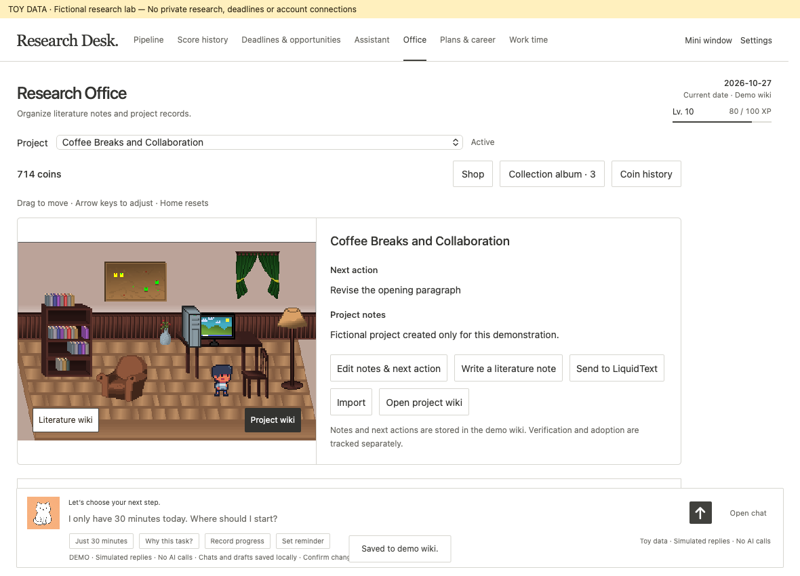

# Research Desk: Momo Demo

Research Desk tracks papers from an idea to publication. It keeps the next action visible and links work to project notes.

Research Desk combines a **paper progress tracker**, project notes, deadlines and work records. It also includes a small office and a personal assistant named **Momo**. The desk helps answer two questions: *What should I work on next? What do I need to resume that work?*

This repository is an **English, offline macOS demo**. It includes eight fictional papers, five fictional deadlines and synthetic work sessions. You can explore and edit the demo without connecting a research account or supplying an API key.

**Live calendar, literature-wiki and LLM integrations are not included.** Momo uses prepared replies. Calendar views use generated records. The connected workflows below describe possible extensions. You cannot enable these integrations in this release.



## A paper progress tracker with context

Research Desk shows each paper's current stage and the researcher's next task. The tracker records their progress.

- Track papers through planning, collection, analysis, abstract, figures, drafting, polishing, submission, revision, resubmission and publication.
- Keep project notes, priorities and deadlines beside the pipeline.
- Record work, undo a stage change, and review progress over time.
- Pin a project and use the floating mini window to keep a next action nearby.
- Explore work-time summaries, monthly achievement cards and optional office rewards.

The office has one owner character and two work areas. Recorded progress unlocks furniture. Momo appears in the assistant area. The office provides access to project and literature workflows. The pipeline provides a direct overview.

## How connected tools could work together

The tracker supplies **project state**. A literature-note wiki supplies **research context**. A calendar supplies **time constraints**. A personal AI assistant could use those inputs to propose a concrete next action. Each source answers a different question.

| Connection | Context it could contribute | What becomes useful together |
| --- | --- | --- |
| Calendar | Available work blocks, meetings and deadlines from selected calendars | Find time for researcher-defined tasks, such as reading a paper or checking a figure. |
| Literature-note wiki | Reading notes, paper summaries and topic tags | Keep reading materials organized and easy to browse. |
| LLM-assisted wiki | Paper progress entries and task status | Record progress for each paper and review completed tasks. |
| Personal AI assistant | Deadlines, reminder preferences and calendar access | Record deadlines from messages. Send reminders and a weekly briefing. |

### Calendar: turn a priority into a feasible work session

A deadline explains urgency, but it does not tell you whether a task fits the next 30 minutes. With a calendar connection, the desk could compare available time with project next actions and suggest a task of suitable scope.

A researcher might use a 30-minute gap to check one figure's labels. A two-hour block might allow a longer reading session. After the session, a confirmed work record could update the project history. Keep scheduled time separate from completed work. A calendar block alone does not establish that the work happened.

**In this demo:** calendar availability and research-hour summaries are synthetic. The refresh command does not read or write a real calendar.

### Literature-note wiki: organize your reading

A literature-note wiki can store paper summaries, reading notes and topic tags. You can browse these materials alongside the paper tracker.

An LLM-assisted wiki could help record paper progress and update task status. You could use it to review completed tasks for each paper. A wiki does not need an LLM to be useful.

**In this demo:** project notes and demo research records persist locally. External literature-wiki and reading-tool actions show a demonstration notice. They do not access a personal library or retrieve sources.

### Personal AI assistant: record deadlines and send reminders

A messaging-based personal AI assistant could make deadline tracking part of an ordinary conversation. Send a message with the deadline and project name. With the required integrations and permissions, the assistant could automatically add the deadline to Research Desk and your calendar.

For example, you could send:

- “The submission deadline is November 20 at 5 p.m. Central Time. Add it to Research Desk and my calendar.”
- “Remind me one week before the deadline, then again the day before.”
- “The deadline moved to November 27. Update the existing entry in both places.”
- “Send me a briefing every Monday morning with upcoming deadlines and reminders for the week.”

Reminders could help you notice approaching deadlines without checking the app each day. A Monday briefing could bring the week's deadlines together in one message.

These are possible connected workflows, not built-in integrations in this release. They require a messaging connection, app and calendar write access, and scheduled notifications. The assistant would need to resolve unclear dates and time zones before adding entries. Updates should change existing entries rather than create duplicates.

**In this demo:** you can track fictional deadlines in the app. Momo's replies are simulated, and confirmation can save a reminder to demo data. The demo does not receive text messages, write to a real calendar or send Monday briefings.

### Example: plan a reading session

1. Keep paper summaries and reading notes in a literature-note wiki.
2. Add a reading task to the paper tracker.
3. Use a connected calendar to find time for the task.
4. Open the notes you want to read.
5. Record the completed session in the tracker or a paper progress entry in the wiki.

This example describes a possible connected workflow. The demo does not automate this sequence.

## Make the office your own

We encourage you to use a coding or image-generation agent to customize the office UI, furniture and collectible artwork. Choose a visual style you enjoy. You can keep the tracker behavior while changing its appearance.

Give the agent a specific scope. Ask it to preserve controls, reward rules and saved data. Review the result in the running app. Keep source credits and check the reuse terms for any replacement artwork. The application license still applies to code changes.

### Create collectibles for each paper

Paper-specific collectibles can make the collection more personal and fun. After you connect selected paper information, ask an agent to design items that reflect each paper.

A researcher-provided title, abstract, research question and keywords can provide enough context for an item design. Share only material you want the agent to process. A manuscript or private dataset is not required.

For example, an agent could propose:

| Fictional paper | Possible collectibles |
| --- | --- |
| Coffee Breaks and Collaboration | An espresso cup, a shared table and a small collaboration network |
| Library Seat Effect | A reading lamp, a window seat and a library card |
| A paper about research careers | A branching path, a conference badge and a publication timeline |

The items can act as reminders of the research behind them. A collection then reflects your papers, rather than only a set of generic objects.

Ask the agent to map each design to the correct project identifier. It should preserve earned items, collection history and existing unlock rules. Review proposed designs before the agent replaces artwork or changes project mappings.

**In this demo:** collectibles use generic stationery themes. The app does not read manuscripts, generate artwork or create paper-specific collections automatically. An agent would need to update the artwork and project mappings separately.

### Example agent prompts

> Customize the office UI and furniture with a quiet pixel-art style. Keep one owner character. Preserve controls, reward rules and saved data. Show a preview before replacing the current artwork. Include source credits and licenses for replacement assets.

> Use the paper titles, abstracts and keywords I provide to propose three collectible items for each paper. Explain how each item relates to its paper. Show the designs for review first. After approval, map them to project identifiers. Preserve earned items, collection history and unlock rules. Do not read other research files.

## Build and launch on macOS

Install Python 3 and Apple's Command Line Tools (`xcode-select --install`). Run these commands from the repository root:

```sh
python3 build.py
open 'dist/Research Desk Demo.app'
python3 install-launcher.py
```

The last command creates **Research Desk Demo.command** on your Desktop. Double-click it to launch the demo. The installer generates the absolute path locally. The repository does not store that path. Reinstall the launcher if you move the checkout. The build uses an ad-hoc signature. It is not notarized.

## What works

- Paper stages, undo, project editing, pinned project and focus timer.
- Deadlines, priorities, participation decisions and completion.
- Plans, score history, research notes and work records.
- Office, rewards, collectible shop, envelopes and monthly achievement cards.
- Floating mini window and local persistence.
- Simulated Momo conversations, confirmation before recording work, and sample task recommendations.
- Synthetic calendar availability and work-time charts.

**AI, calendar and literature connections are simulations.** No cloud sync, real model calls, live calendar, original wiki or production backup is connected. External integration buttons show an explanatory notice. This repository contains only the standalone demo.

## Data boundary

The build generates fresh toy inputs. The demo stores its wiki and chat under `dist/Demo Data/`. It also stores its own macOS preferences. The repository includes no personal research files. The build does not require them. Never put sensitive text into a presentation session.

A rebuild preserves the existing Demo Data folder. For a fresh tour, quit the app. Rename the Demo Data folder and retain it if you want to keep prior edits. Reopen the app to create fresh demo data. Git ignores the generated app, session data and verification outputs. This README includes the selected toy-data screenshot in `docs/`.

## Suggested tour

Pipeline → deadlines → Momo's “Just 30 minutes” shortcut → office and collectibles → plans → work-time charts → mini window. Record an activity or finish a stage to demonstrate rewards. The synthetic activity history starts with enough progress to show unlocked decorations.

## Verification

```sh
python3 tests/check.py
```

This script checks privacy boundaries and JavaScript syntax. It then compiles and runs isolated native checks:

- Fixture validation, stage editing, reload and undo.
- All five decoration toggles and their saved state.
- Simulated chat confirmation and saved conversations.
 GUI screenshots are a separate manual check. macOS file coordination may require running outside a restricted automation sandbox.

## Artwork

Office furniture and the single owner character: [Pixel Office Asset Pack by 2dPig](https://2dpig.itch.io/pixel-office), CC0 1.0. Momo's cat artwork permits free reuse. See [ASSETS.md](ASSETS.md) for all source credits, adaptations and separate artwork permissions.

## License: noncommercial use

Application code and documentation use **PolyForm Noncommercial License 1.0.0**. See [LICENSE](LICENSE) for the full terms.

You may use, modify and share the software for purposes permitted by that license. It permits noncommercial uses and specifies permitted personal and organizational uses. These include educational institutions and public research organizations, regardless of their funding sources or funding obligations. Commercial uses outside those permissions require a separate license from Jina Lee.

This is source-available software, not OSI-approved open-source software. A public repository does not grant unrestricted commercial use.

Third-party assets keep their original licenses. The 2dPig office assets remain CC0. Momo retains its existing free reuse permission. These separate artwork permissions do not authorize commercial use of the application code.

This license applies to this demo release. It does not revoke permissions granted for earlier releases or separately licensed assets.
